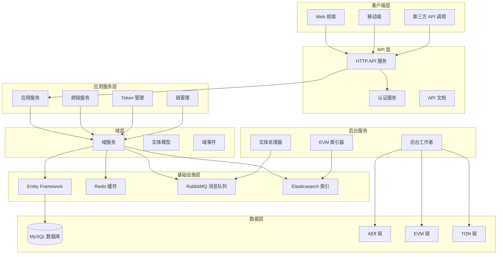

# AElf eBridge 跨链服务器架构文档

## 项目概述

AElf eBridge 是一个基于 .NET ABP 框架开发的企业级跨链服务器系统，旨在提供多区块链网络之间的安全、高效的跨链资产转移和数据同步服务。该系统支持同构和异构链之间的互操作性，为用户提供无缝的跨链体验。

## 系统架构概览

### 整体架构图



## 支持的区块链网络

### 区块链类型枚举
- **AElf**: AElf 主链和侧链
- **EVM**: 以太坊兼容链（Ethereum、BSC、Base 等）
- **TVM**: TON 虚拟机链

### 支持的具体网络
1. **AElf 网络**
   - MainChain AELF (链 ID: 9992731)
   - SideChain tDVW (链 ID: 1931928)

2. **EVM 兼容网络**
   - Ethereum Sepolia 测试网
   - BSC 测试网
   - Base Sepolia 测试网

3. **TON 网络**
   - TON 测试网

## 核心模块详解

### 1. 跨链转账模块 (CrossChain)

#### 核心组件
- `CrossChainTransferAppService`: 跨链转账应用服务
- `HomogeneousCrossChainTransferProvider`: 同构链转账提供者
- `HeterogeneousCrossChainTransferProvider`: 异构链转账提供者

#### 转账流程
1. **发起转账**: 用户在源链发起跨链转账交易
2. **事件监听**: 系统监听源链的转账事件
3. **创建收据**: 在目标链创建转账收据
4. **资产释放**: 在目标链释放对应资产给用户

#### 跨链类型
- **同构跨链** (Homogeneous): AElf 主链与侧链之间
- **异构跨链** (Heterogeneous): AElf 与 EVM/TON 之间

### 2. EVM 索引器模块

#### EVM 事件处理器
- `NewReceiptEventProcessor`: 处理 EVM 链新收据事件
- `TokenSwappedEventProcessor`: 处理 EVM Token 交换事件

#### 事件同步机制
- **实时监听**: 监听 EVM 链上的合约事件
- **事件解析**: 解析事件数据并转换为系统内部格式
- **状态更新**: 根据事件更新跨链转账状态

### 3. 实体处理器模块

#### 核心功能
- **实体事件处理**: 处理域实体的创建、更新、删除事件
- **索引同步**: 将实体变更同步到 Elasticsearch 索引
- **消息队列集成**: 通过 RabbitMQ 处理分布式事件

#### 主要处理器
- `CrossChainTransferEntityHandler`: 处理跨链转账实体事件
- `CrossChainIndexingInfoEntityHandler`: 处理跨链索引信息事件
- `CrossChainDailyLimitEntityHandler`: 处理每日限额实体事件

### 4. Token 管理模块

#### 功能特性
- **Token 映射**: 维护不同链之间的 Token 映射关系
- **价格管理**: 集成多个价格源，提供实时 Token 价格
- **流动性监控**: 监控跨链池的流动性状态
- **多币种支持**: 支持 ELF、ETH、BNB、BTC 等主流代币

#### 核心组件
- `TokenAppService`: Token 应用服务
- `TokenSymbolMappingProvider`: Token 符号映射提供者
- `AggregatePriceProvider`: 聚合价格提供者
- `LiquidityAppService`: 流动性服务

### 5. 区块链客户端模块

#### 客户端提供者
- `AElfClientProvider`: AElf 链客户端
- `EVMClientProvider`: EVM 链客户端
- `TonClientProvider`: TON 链客户端

#### 功能支持
- **交易广播**: 向各链广播交易
- **状态查询**: 查询链上状态和数据
- **事件订阅**: 订阅链上事件通知
- **合约调用**: 调用智能合约方法

### 6. 后台工作者模块

#### 工作者类型
- `CrossChainTransferIndexerSyncProvider`: 跨链转账索引同步
- `CrossChainIndexingInfoIndexerSyncProvider`: 跨链索引信息同步
- `EvmNewReceiptSyncProvider`: EVM 新收据同步
- `TonIndexSyncWorker`: TON 索引同步
- `CheckAElfTransactionConfirmedWorker`: AElf 交易确认检查
- `CheckEvmTransactionConfirmedWorker`: EVM 交易确认检查

#### 执行机制
- **定时任务**: 按照配置的时间间隔执行同步任务
- **增量同步**: 只同步新增的区块和交易
- **状态检查**: 定期检查数据一致性
- **重试机制**: 失败自动重试和错误恢复

## 技术栈与架构模式

### 核心技术栈
- **.NET 8.0**: 主要开发框架
- **ABP Framework**: 企业级应用框架
- **Entity Framework Core**: ORM 框架
- **MySQL**: 主数据库
- **Redis**: 缓存和分布式锁
- **RabbitMQ**: 消息队列
- **Elasticsearch**: 搜索和分析引擎
- **Docker**: 容器化部署

### 架构模式
- **领域驱动设计 (DDD)**: 核心业务逻辑组织
- **CQRS**: 命令查询责任分离
- **事件驱动架构**: 基于事件的松耦合设计
- **微服务架构**: 模块化服务拆分
- **分层架构**: 清晰的层次划分

## 项目结构说明

### 源代码模块 (src/)
```
├── AElf.CrossChainServer.Domain.Shared/          # 共享域定义
├── AElf.CrossChainServer.Domain/                 # 域层
├── AElf.CrossChainServer.Application.Contracts/  # 应用合约
├── AElf.CrossChainServer.Application/             # 应用层
├── AElf.CrossChainServer.EntityFrameworkCore/    # 数据访问层
├── AElf.CrossChainServer.HttpApi/                # HTTP API
├── AElf.CrossChainServer.HttpApi.Client/         # HTTP API 客户端
├── AElf.CrossChainServer.HttpApi.Host/           # API 宿主
├── AElf.CrossChainServer.AuthServer/             # 认证服务
├── AElf.CrossChainServer.Worker/                 # 后台工作者
├── AElf.CrossChainServer.EntityHandler.Core/     # 实体处理核心
├── AElf.CrossChainServer.EntityHandler/          # 实体处理器
├── AElf.CrossChainServer.EvmIndexer/             # EVM 索引器
├── AElf.CrossChainServer.AetherlinkApi/          # AetherLink API
└── AElf.CrossChainServer.DbMigrator/             # 数据库迁移
```

### 测试模块 (test/)
```
├── AElf.CrossChainServer.TestBase/               # 测试基础
├── AElf.CrossChainServer.Application.Tests/      # 应用层测试
├── AElf.CrossChainServer.Domain.Tests/           # 域层测试
├── AElf.CrossChainServer.EntityFrameworkCore.Tests/ # EF 测试
└── AElf.CrossChainServer.HttpApi.Client.ConsoleTestApp/   # 客户端测试
```

## 部署架构

### 服务组件
1. **API 服务**: 对外提供 REST API
2. **认证服务**: 处理用户认证和授权
3. **后台工作者**: 执行定时任务和数据同步
4. **EVM 索引器**: 处理 EVM 链事件索引
5. **实体处理器**: 处理数据实体变更和索引同步

### 依赖服务
- **MySQL**: 主数据存储
- **Redis**: 缓存和会话存储
- **RabbitMQ**: 消息队列服务
- **Elasticsearch**: 索引和搜索服务

### 外部集成
- **区块链节点**: 各条链的 RPC 节点
- **GraphQL 端点**: 索引器数据查询
- **价格 API**: 第三方价格数据源

## 安全机制

### 认证与授权
- **OpenIddict**: OAuth 2.0/OpenID Connect 实现
- **JWT Token**: 无状态身份验证
- **API Key**: 第三方接入控制
- **权限管理**: 基于角色的访问控制

### 数据安全
- **数据加密**: 敏感数据加密存储
- **传输安全**: HTTPS/TLS 加密传输
- **私钥管理**: 安全的私钥存储和使用
- **审计日志**: 完整的操作审计跟踪

### 跨链安全
- **Merkle 证明**: 跨链数据验证
- **多重签名**: 关键操作多重确认
- **限额控制**: 转账金额和频率限制
- **监控告警**: 异常行为实时监控

## 监控与运维

### 日志系统
- **Serilog**: 结构化日志记录
- **日志级别**: Debug、Info、Warning、Error
- **日志聚合**: 集中化日志收集和分析

### 性能监控
- **健康检查**: 服务健康状态监控
- **性能指标**: 响应时间、吞吐量监控
- **资源监控**: CPU、内存、网络使用率

### 告警机制
- **异常告警**: 系统异常实时通知
- **性能告警**: 性能指标超阈值告警
- **业务告警**: 关键业务流程异常告警

## 扩展性设计

### 水平扩展
- **无状态设计**: 支持多实例部署
- **负载均衡**: 请求分发和流量控制
- **数据库读写分离**: 提升数据库性能

### 功能扩展
- **插件架构**: 支持新区块链接入
- **配置驱动**: 通过配置支持新功能
- **事件系统**: 基于事件的功能扩展

### 性能优化
- **缓存策略**: 多层缓存提升响应速度
- **异步处理**: 非阻塞的异步操作
- **批量处理**: 批量数据处理优化

## 开发与部署指南

### 开发环境要求
- .NET 8.0 SDK
- MySQL 8.0+
- Redis 6.0+
- RabbitMQ 3.8+
- Elasticsearch 7.15.0

### 配置管理
- **环境配置**: 支持多环境配置切换
- **密钥管理**: 安全的配置信息管理
- **动态配置**: 运行时配置热更新

### 部署方式
- **Docker 部署**: 容器化部署方案
- **K8s 部署**: Kubernetes 集群部署
- **传统部署**: 物理服务器部署

## 最佳实践

### 代码规范
- **命名约定**: 统一的命名规范
- **代码审查**: 强制代码审查流程
- **单元测试**: 高覆盖率的单元测试
- **文档维护**: 及时更新技术文档

### 数据管理
- **数据备份**: 定期数据备份策略
- **数据迁移**: 平滑的数据迁移方案
- **数据归档**: 历史数据归档处理
- **数据一致性**: 保证跨链数据一致性

### 故障处理
- **故障预案**: 完整的故障处理预案
- **快速恢复**: 最小化服务中断时间
- **根因分析**: 深入的故障原因分析
- **持续改进**: 基于故障的系统改进

---

本架构文档将随着系统的发展持续更新，确保文档与实际系统保持同步。如有任何疑问或建议，请联系开发团队。 