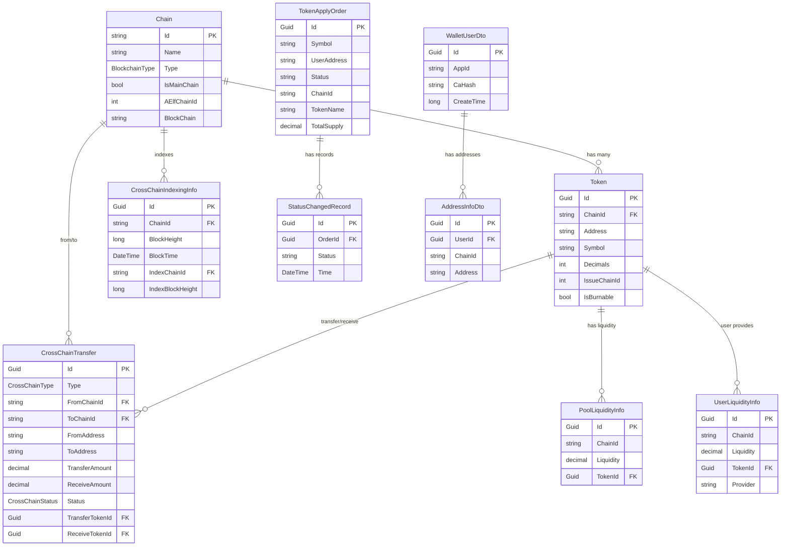

# AElf eBridge 域实体文档

## 概述

本文档详细描述了 `AElf.CrossChainServer.Domain` 层中的所有实体类，包括每个类的字段定义、用途说明以及类与类之间的关系。

## 实体继承层次结构

### 基础实体类

#### `CrossChainServerEntity` 
系统所有实体的根基类，提供基础的实体功能。

**字段说明:**
- 抽象基类，没有具体字段
- 实现了 `IEntity` 接口
- 提供了实体比较和键值获取的通用方法

#### `CrossChainServerEntity<TKey>`
泛型实体基类，为所有实体提供标识符。

**字段说明:**
- `Id: TKey` - 实体的唯一标识符，类型为泛型 TKey

#### `MultiChainEntity<TKey>`
多链实体基类，为跨多个区块链的实体提供基础结构。

**继承关系:** `CrossChainServerEntity<TKey>` → `IMultiChain`

**字段说明:**
- `ChainId: string` - 区块链标识符 (继承自 IMultiChain 接口)

## 核心业务实体

### 1. 区块链相关实体

#### `Chain` - 区块链信息
表示系统支持的区块链网络信息。

**继承关系:** `CrossChainServerEntity<string>`

**字段说明:**
- `Id: string` - 链的唯一标识符 (主键)
- `Name: string` - 链的显示名称 (不能为空)
- `Type: BlockchainType` - 区块链类型 (AElf/EVM/TVM)
- `IsMainChain: bool` - 是否为主链
- `AElfChainId: int` - AElf 体系内的链 ID
- `BlockChain: string` - 区块链网络名称

**业务关系:**
- 与 `Token` 实体存在一对多关系 (一条链可以有多个代币)
- 与 `CrossChainTransfer` 的源链和目标链字段相关联
- 与 `CrossChainIndexingInfo` 存在关联关系

### 2. 代币相关实体

#### `Token` - 代币信息
表示系统中的代币资产信息。

**继承关系:** `MultiChainEntity<Guid>`

**字段说明:**
- `Id: Guid` - 代币的唯一标识符 (主键)
- `ChainId: string` - 所属区块链 ID (继承自父类)
- `Address: string` - 代币合约地址 (不能为空)
- `Symbol: string` - 代币符号 (不能为空)
- `Decimals: int` - 代币精度位数
- `IssueChainId: int` - 发行链 ID
- `IsBurnable: bool` - 是否可销毁

**业务关系:**
- 通过 `ChainId` 与 `Chain` 实体关联
- 被 `CrossChainTransfer` 实体引用 (转出和接收代币)
- 与 `PoolLiquidityInfo` 和 `UserLiquidityInfo` 存在关联

### 3. 跨链转账相关实体

#### `CrossChainTransferBase` - 跨链转账基类
包含跨链转账的核心字段定义。

**继承关系:** `CrossChainServerEntity<Guid>`

**字段说明:**
- `Id: Guid` - 转账记录唯一标识符 (主键)
- `Type: CrossChainType` - 跨链类型 (同构/异构)
- `FromChainId: string` - 源链 ID
- `ToChainId: string` - 目标链 ID
- `FromAddress: string` - 发送方地址
- `ToAddress: string` - 接收方地址
- `TransferTransactionId: string` - 转账交易 ID
- `ReceiveTransactionId: string` - 接收交易 ID
- `InlineTransferTransactionId: string` - 内联转账交易 ID // 未使用，之前为适应底层aa地址跨链增加的
- `TransferTime: DateTime` - 转账时间
- `TransferBlockHeight: long` - 转账区块高度
- `ReceiveTime: DateTime` - 接收时间
- `ReceiveBlockHeight: long` - 接收区块高度
- `TransferAmount: decimal` - 转账金额
- `ReceiveAmount: decimal` - 接收金额
- `Status: CrossChainStatus` - 跨链状态 (已转账/已索引/已接收)
- `ReceiptId: string` - 收据 ID
- `Progress: int` - 进度百分比
- `ProgressUpdateTime: DateTime` - 进度更新时间
- `ReceiveTransactionAttemptTimes: int` - 接收交易尝试次数
- `TraceId: string` - 追踪 ID
- `TransferStatus: ReceiptStatus` - 转账状态 (初始化中/待处理/已确认)
- `ReceiveStatus: ReceiptStatus` - 接收状态

#### `CrossChainTransfer` - 跨链转账记录
具体的跨链转账实体，继承基类并添加代币引用。

**继承关系:** `CrossChainTransferBase`

**字段说明:**
- `TransferTokenId: Guid` - 转出代币 ID (外键引用 Token)
- `ReceiveTokenId: Guid` - 接收代币 ID (外键引用 Token)

**业务关系:**
- 通过 `TransferTokenId` 和 `ReceiveTokenId` 与 `Token` 实体关联
- 通过 `FromChainId` 和 `ToChainId` 与 `Chain` 实体关联

#### `CrossChainIndexingInfo` - 跨链索引信息
记录跨链索引同步信息。

**继承关系:** `MultiChainEntity<Guid>`

**字段说明:**
- `Id: Guid` - 索引记录唯一标识符 (主键)
- `ChainId: string` - 当前链 ID (继承自父类)
- `BlockHeight: long` - 当前链区块高度
- `BlockTime: DateTime` - 区块时间
- `IndexChainId: string` - 被索引的链 ID
- `IndexBlockHeight: long` - 被索引的区块高度

**业务关系:**
- 通过 `ChainId` 和 `IndexChainId` 与 `Chain` 实体关联

### 4. 限流控制实体

#### `CrossChainDailyLimitBase` - 每日限额基类
控制跨链转账的每日限额。

**继承关系:** `MultiChainEntity<Guid>`

**字段说明:**
- `Id: Guid` - 限额记录唯一标识符 (主键)
- `ChainId: string` - 源链 ID (继承自父类)
- `TargetChainId: string` - 目标链 ID
- `Type: CrossChainLimitType` - 限制类型 (收据/交换)
- `RemainAmount: decimal` - 剩余可用额度
- `RefreshTime: long` - 刷新时间戳
- `DailyLimit: decimal` - 每日限额

#### `CrossChainRateLimitBase` - 速率限制基类
控制跨链转账的速率限制 (令牌桶算法)。

**继承关系:** `MultiChainEntity<Guid>`

**字段说明:**
- `Id: Guid` - 速率限制记录唯一标识符 (主键)
- `ChainId: string` - 源链 ID (继承自父类)
- `TargetChainId: string` - 目标链 ID
- `Type: CrossChainLimitType` - 限制类型
- `CurrentAmount: decimal` - 当前桶中的令牌数
- `Capacity: decimal` - 桶的容量
- `Rate: decimal` - 令牌补充速率
- `IsEnable: bool` - 是否启用限流

### 5. 流动性管理实体

#### `LiquidityBase` - 流动性基类
提供流动性管理的基础字段。

**继承关系:** `CrossChainServerEntity<Guid>`

**字段说明:**
- `Id: Guid` - 流动性记录唯一标识符 (主键)
- `ChainId: string` - 区块链 ID
- `Liquidity: decimal` - 流动性数量

#### `PoolLiquidityInfo` - 池流动性信息
记录代币池的流动性信息。

**继承关系:** `LiquidityBase`

**字段说明:**
- `TokenId: Guid` - 代币 ID (外键引用 Token)

**业务关系:**
- 通过 `TokenId` 与 `Token` 实体关联

#### `UserLiquidityInfo` - 用户流动性信息
记录用户提供的流动性信息。

**继承关系:** `LiquidityBase`

**字段说明:**
- `TokenId: Guid` - 代币 ID (外键引用 Token)
- `Provider: string` - 流动性提供者地址

**业务关系:**
- 通过 `TokenId` 与 `Token` 实体关联

### 6. 代币访问控制实体

#### `UserTokenAccessInfoBase` - 用户代币访问基类
管理用户申请代币访问的基础信息。

**继承关系:** `CrossChainServerEntity<Guid>`

**字段说明:**
- `Id: Guid` - 访问记录唯一标识符 (主键)
- `Symbol: string` - 代币符号
- `Address: string` - 用户地址
- `OfficialWebsite: string` - 官方网站 (可选)
- `OfficialTwitter: string` - 官方 Twitter (可选)
- `Title: string` - 标题 (可选)
- `PersonName: string` - 联系人姓名 (可选)
- `TelegramHandler: string` - Telegram 账号 (可选)
- `Email: string` - 联系邮箱

#### `ThirdUserTokenIssueBase` - 第三方用户代币发行基类
管理第三方用户代币发行申请。

**继承关系:** `CrossChainServerEntity<Guid>`

**字段说明:**
- `Id: Guid` - 发行记录唯一标识符 (主键)
- `Address: string` - AElf 链地址
- `WalletAddress: string` - EVM 链钱包地址
- `Symbol: string` - 代币符号
- `ChainId: string` - AElf 链 ID
- `CreateTime: long` - 创建时间戳
- `UpdateTime: long` - 更新时间戳
- `TokenName: string` - 代币名称
- `TokenImage: string` - 代币图标 (文本字段，不索引)
- `OtherChainId: string` - 其他链 ID
- `TotalSupply: string` - 总发行量
- `ContractAddress: string` - 合约地址
- `BindingId: string` - 绑定 ID
- `ThirdTokenId: string` - 第三方代币 ID
- `Status: string` - 发行状态

#### `TokenApplyOrderBase` - 代币申请订单基类
代币申请订单的基础字段。

**继承关系:** `CrossChainServerEntity<Guid>`

**字段说明:**
- `Id: Guid` - 订单唯一标识符 (主键)
- `Symbol: string` - 代币符号
- `UserAddress: string` - 用户地址
- `Status: string` - 订单状态
- `CreateTime: long` - 创建时间戳
- `UpdateTime: long` - 更新时间戳

#### `TokenApplyOrder` - 代币申请订单
完整的代币申请订单信息。

**继承关系:** `TokenApplyOrderBase`

**字段说明:**
- `ChainId: string` - 区块链 ID
- `ChainName: string` - 区块链名称
- `TokenName: string` - 代币名称
- `TotalSupply: decimal` - 总发行量
- `Decimals: int` - 代币精度
- `Icon: string` - 代币图标
- `PoolAddress: string` - 池地址
- `ContractAddress: string` - 合约地址
- `StatusChangedRecords: List<StatusChangedRecord>` - 状态变更记录列表

**业务关系:**
- 与 `StatusChangedRecord` 存在一对多关系

#### `StatusChangedRecord` - 状态变更记录
记录订单状态变更历史。

**继承关系:** `CrossChainServerEntity<Guid>`

**字段说明:**
- `Id: Guid` - 记录唯一标识符 (主键)
- `OrderId: Guid` - 订单 ID (外键)
- `Status: string` - 变更后的状态
- `Time: DateTime` - 变更时间
- `Order: TokenApplyOrder` - 订单导航属性

**业务关系:**
- 通过 `OrderId` 与 `TokenApplyOrder` 实体关联 (多对一)

### 7. 钱包用户管理实体

#### `WalletUserDto` - 钱包用户信息
管理钱包用户的基础信息。

**继承关系:** `CrossChainServerEntity<Guid>`

**字段说明:**
- `Id: Guid` - 用户唯一标识符 (主键)
- `AppId: string` - 应用 ID
- `CaHash: string` - CA 哈希值
- `AddressInfos: List<AddressInfoDto>` - 地址信息列表
- `CreateTime: long` - 创建时间戳
- `ModificationTime: long` - 修改时间戳

**业务关系:**
- 与 `AddressInfoDto` 存在一对多关系

#### `AddressInfoDto` - 地址信息
用户在不同链上的地址信息。

**继承关系:** `CrossChainServerEntity<Guid>`

**字段说明:**
- `Id: Guid` - 地址记录唯一标识符 (主键)
- `UserId: Guid` - 用户 ID (外键)
- `ChainId: string` - 链 ID
- `Address: string` - 地址
- `WalletUser: WalletUserDto` - 钱包用户导航属性

**业务关系:**
- 通过 `UserId` 与 `WalletUserDto` 实体关联 (多对一)

## 枚举类型定义

### `BlockchainType` - 区块链类型
```csharp
public enum BlockchainType
{
    AElf,    // AElf 区块链
    Evm,     // 以太坊虚拟机兼容链
    Tvm      // TON 虚拟机链
}
```

### `CrossChainType` - 跨链类型
```csharp
public enum CrossChainType
{
    Homogeneous,    // 同构跨链 (AElf 生态内)
    Heterogeneous   // 异构跨链 (不同生态间)
}
```

### `CrossChainStatus` - 跨链状态
```csharp
public enum CrossChainStatus
{
    Transferred,    // 已转账
    Indexed,        // 已索引
    Received        // 已接收
}
```

### `ReceiptStatus` - 收据状态
```csharp
public enum ReceiptStatus
{
    Initializing,   // 初始化中
    Pending,        // 待处理
    Confirmed       // 已确认
}
```

### `CrossChainLimitType` - 跨链限制类型
```csharp
public enum CrossChainLimitType
{
    Receipt,    // 收据类型限制
    Swap        // 交换类型限制
}
```

### `TokenApplyOrderStatus` - 代币申请订单状态
```csharp
public enum TokenApplyOrderStatus
{
    Unissued,           // 未发行
    Issuing,            // 发行中
    Issued,             // 已发行
    PoolInitializing,   // 池初始化中
    PoolInitialized,    // 池已初始化
    Complete,           // 完成
    Failed              // 失败
}
```

### `TransferType` - 转账类型
```csharp
public enum TransferType
{
    Transfer,   // 转出
    Receive     // 接收
}
```

## 实体关系图



## 索引和存储说明

### Elasticsearch 索引
系统中的实体使用 Elasticsearch 进行索引存储，主要字段标注说明：
- `[Keyword]`: 精确匹配字段，用于查询过滤
- `[Text(Index = false)]`: 文本字段但不索引，用于存储大文本内容

### 数据库设计原则
1. **单一职责**: 每个实体类专注于特定的业务领域
2. **继承层次**: 通过基类共享通用字段，减少重复
3. **关系明确**: 通过外键和导航属性建立清晰的实体关系
4. **状态管理**: 使用枚举类型确保状态值的一致性
5. **审计跟踪**: 包含时间戳字段支持数据变更追踪

## 扩展性设计

### 多链支持
- 通过 `IMultiChain` 接口和 `MultiChainEntity` 基类支持多链场景
- `ChainId` 字段统一标识不同的区块链网络

### 状态机制
- 使用枚举类型定义各种状态，支持状态流转
- 状态变更记录实体提供完整的状态历史追踪

### 限流控制
- 分别实现每日限额和速率限制两种限流机制
- 支持不同链对之间的独立限流配置

---

本文档涵盖了域层的所有核心实体，为系统的数据模型设计和业务逻辑实现提供了完整的参考。随着业务需求的变化，实体设计将持续演进和优化。 